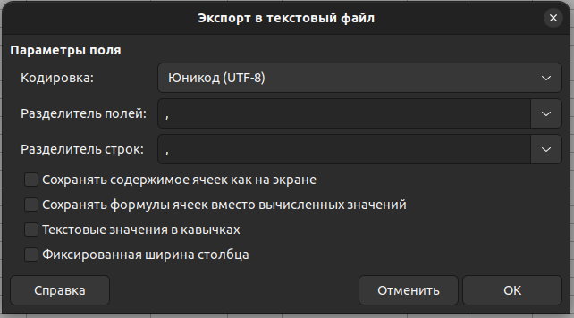
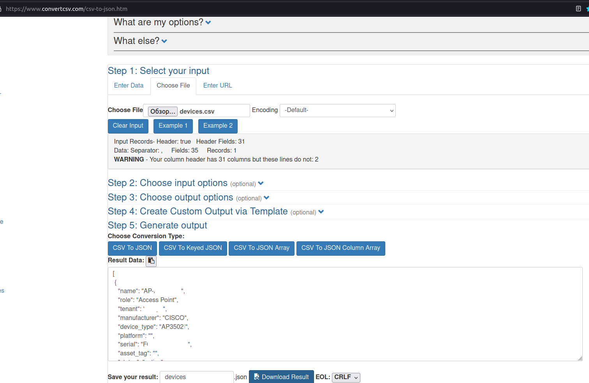

## Импорт устройств в Netbox с помощью CSV, JSON, YAML
https://habr.com/ru/sandbox/257762/

### Введение

Работа с большим количеством серверов, сетевых и других устройств требует не только внимательности, но и эффективных инструментов для управления инфраструктурой. Одним из таких инструментов является NetBox, который упрощает инвентаризацию и автоматизацию задач. Однако ручной ввод информации может быть трудоёмким и подверженным ошибкам. В этой статье мы рассмотрим пошаговый процесс импорта устройств в NetBox с помощью файлов форматов CSV, JSON и YAML, что позволит ускорить работу и избежать типичных проблем при заполнении данных.

### Для начала создаем файл

Поля должны называться согласно страницы импорта в Netbox

#### Примеры csv файлов

1.devices.csv

2.interface.csv

3.ipaddress.csv

4.cable.csv

*Нельзя повторять название устройств*

    Нельзя повторять в столбце name название AP_01 и AP_01 одинаковы, даже если адреса разные

Если необходимо перед\после во все столбы добавить одно и тоже слово, например "/24"

В Libreoffice можно с помощью "Найти и заменить" выделить нужные ячейки и установить "птички" "Регулярное выражение" и "Только текущее 

выделение"\

В поле Найти:^. — крышечка, точка, звёздочка

В поле **Заменить на *&/24

### Сохранить файл xlsx в формат csv

В LibreOffice выбрать Файл - Сохранить как…, с такими параметрами

### Для конвертации в JSON формат можно выбрать любой онлайн ресурс, например Convert CSV to JSON

https://www.convertcsv.com/csv-to-json.htm

Step 1: Select your input - Choose File - Нажать кнопку обзор

Скачать json файл, нажав Download Result

### Импорт файла в формате JSON

Переходим на страницу Devices (или другую страницу для которой предназначен файл), выбираем Import, далее нажать Upload file

Внизу видим Field Options:

Field - это название поля в таблице Excel,

Required (если стоит галочка - обязательный параметр, должен быть в таблице)

Остальные поля необязательные

    У некоторых строк справа есть знак вопроса, можно узнать какое значение нужно указывать для поля * (например для поля status значение указываем из столбца Import Value)

Если каких то обязательных полей нет в Netbox

    Идём в соответствующий раздел и создаём их начиная с шага один. Для примера поле device_type.Переходим на страницу Device Types, далее можно добавить вручную если типов устройств немного или следуя первому шагу.

При успешном импорте появятся добавленная таблица и надпись Imported <кол-во устройств> devices (импортировал сначала по 50, потом решил около 300 импортировать всё прошло успешно, только долго ждать) Если покажет ошибку то смотреть её описание (скорей всего это неправильно названы столбцы, нет такого устройства, возможно пробел в ячейку попал).

Инструкция проверялась на версии NetBox 3.6.2
### Заключение

Импорт данных в NetBox с использованием CSV, JSON или YAML даёт возможность значительно упростить администрирование и поддержание актуальности инвентаря. Следуя приведённым шагам, можно без лишних ошибок загрузить устройства, интерфейсы и адреса, а также быстро адаптировать процесс под собственные нужды. Такой подход особенно полезен при работе с крупными проектами, где автоматизация и точность данных играют ключевую роль.
